<div align="center">
  
  <h1>Nagi</h1>
  <p><strong>A little space. More control.</strong></p>
  <p>A glass desktop companion for Windows 11. Your apps, music and useful information, tucked into the edge of your screen.</p>
  <p><a href="https://github.com/alaaeddinemekkaoui/Nagi/releases/latest"><strong>Latest release · Windows 11 x64</strong></a> · Portable EXE / ZIP · EXE installer · No account required</p>
  <p><a href="https://nagi-notch.vercel.app">Interactive website</a> · <a href="#download">Download</a> · <a href="#see-what-nagi-can-do">Features</a> · <a href="https://nagi-notch.vercel.app/roadmap">Roadmap</a> · <a href="docs/USER-GUIDE.md">Full guide</a></p>
</div>

---

## See what Nagi can do

Nagi stays small until you need it. Hover the screen-edge drop for your dock, hover a widget for its controls, or click the logo for a resizable control center. The floating navigation brings **Overview, Profiles, Utilities and Settings** together.

<p align="center">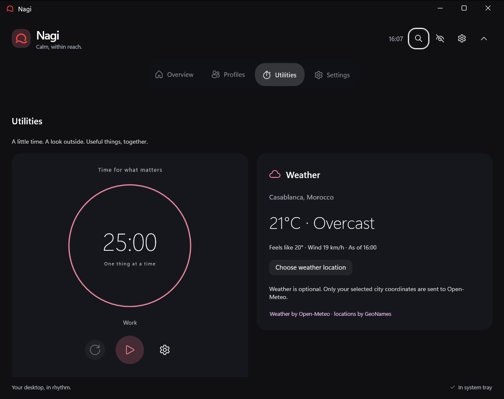</p>

Explore the [interactive feature tour](https://nagi-notch.vercel.app). Try the timer, music, profiles and four themes in your browser, then download at the end. Website previews illustrate the controls; the native app screenshots below show Nagi itself.

### 01 · The notch

A tiny edge-connected drop at rest. A compact live notch when a timer is running or music is playing. Its rounded silhouette fits the content, follows the app theme and expands smoothly into the dock. Top and bottom activity is horizontal; left and right activity stays vertical.

| At rest | Timer running | Timer finished |
| --- | --- | --- |
|  |  |  |

Keep live activity visible without hovering, or disable it for a quieter desktop. A brief green check and **00:00** still appear when a hidden timer finishes.

### 02 · Utilities and focus timer

Open **Utilities** for a circular timer and city weather. Start, pause, resume or reset the same countdown that appears in your dock and notch. The progress ring is native vector geometry, with no continuous rendering loop.

Set **minutes and automatic start inside each profile**. Focus has a 30-minute default. Utilities also offers **Show timer widget** for the active profile. Hover the enabled timer widget for its circular controls; clicking it opens Utilities. An active timer keeps running when you change profiles. Closing Nagi cancels it.

Weather is optional. Choose a city and Celsius/Fahrenheit under Weather settings; Utilities shows its current conditions. Nagi uses Open-Meteo with GeoNames city search, without GPS or IP geolocation.

### 03 · Music and audio

See artwork and measured audio bars in the live notch. The dock keeps a rounded artwork/title/playback card, with a small visualizer while music plays. Long titles expand on hover. The bar count adapts to available space so audio graphics stay inside the widget.

<p></p>

- Control supported **Windows media sessions**, with available artwork, play/pause and previous/next commands.
- Open **local music and video**, including multiple-file queues, under Settings → Music. Supported formats depend on Windows codecs.
- Choose **Windows accent or custom color** for rounded audio bars in Music or Appearance settings.
- When nothing is playing, open **Spotify, YouTube Music or Apple Music**. Pick a preferred service to show only that one.
- Volume, output-device selection, mute and microphone controls stay close by. The dock timer has its own place, separate from volume.

Media support depends on the source player. Audio meters do not save or transmit raw audio.

### 04 · Dock and profiles

A compact **single-row dock without scrolling**. CPU/GPU values sit above their names; weather, battery and timer use matching stacked values and icons. Microphone, weather and battery widgets are optional. Battery appears only when a physical battery is detected.

<p></p>

Up to **two app shortcuts** appear directly. More apps share a **folder that expands on hover or click**, with a maximum of four apps per row. Apps open when clicked; optional app launching is limited to explicit manual profile activation.

<p></p>

Choose **Default, Work, Gaming, Stream, Focus**, or create your own named profiles. Open a profile card to choose apps, visible widgets, timer duration and **When to activate** executable rules. Automatic detection follows the foreground executable. Manual selections stay locked until you choose **Use automatic profiles**.

<p>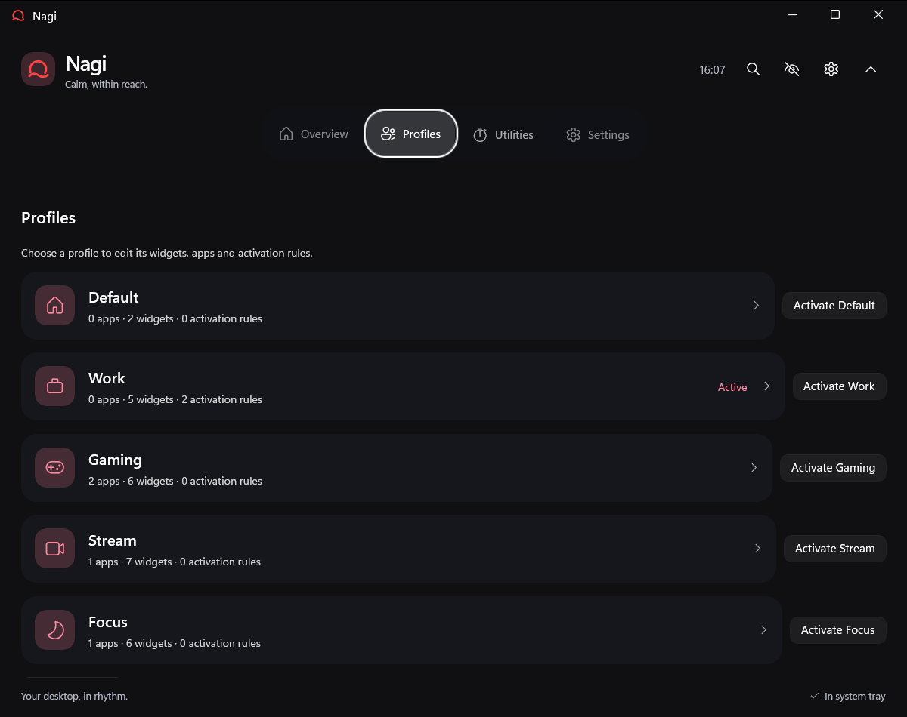</p>

Default starts without apps, with search, CPU/GPU and now playing. Work and Gaming suggest useful installed apps. Stream can show an OBS shortcut, **recording/streaming hover controls and three scene buttons**, or hide OBS entirely.

### 05 · Themes and glass

The dock, notch, hover panels and windows share one material. Choose **Glass, Dark, Light or Akeno**. Dark and Light offer a Windows-accent or custom background tint shared with the notch. Glass follows Windows light/dark preferences and hides separate notch color controls. Reduced motion, high contrast and Windows transparency preferences are respected.

| Glass | Dark |
| --- | --- |
| 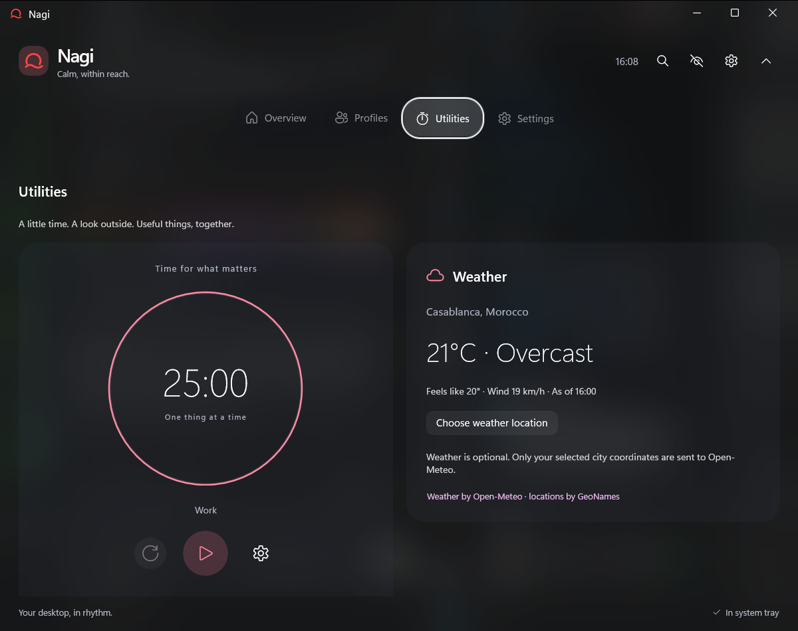 | 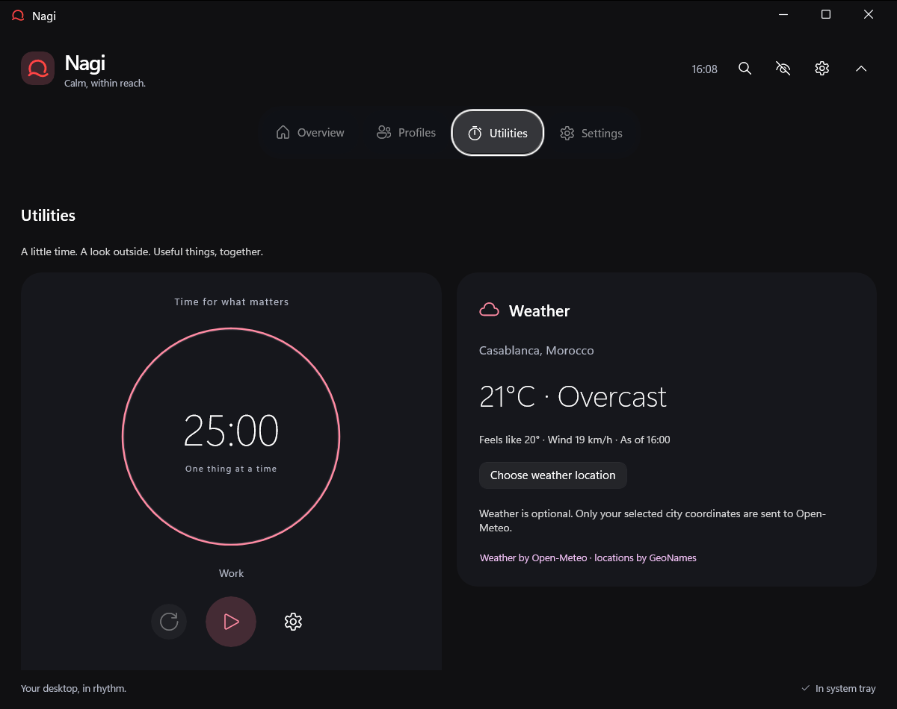 |
| **Light** | **Akeno** |
| 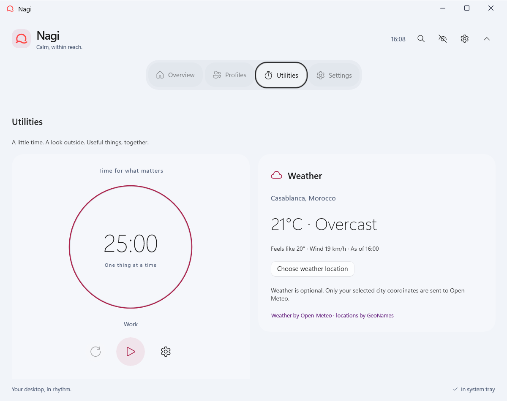 | 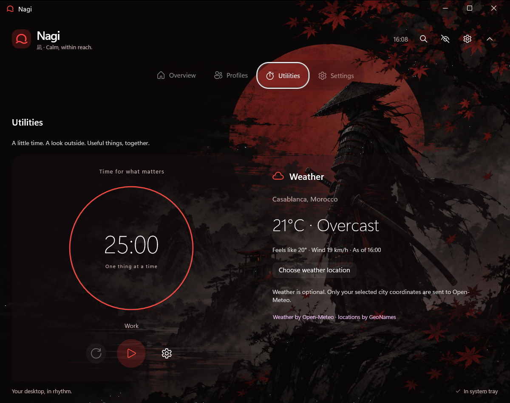 |

Akeno offers **Samurai**, **Gradient** or **None** for the background. The full [samurai artwork](docs/images/nagi-samurai.png) is included in the repository and release assets.

<details>
<summary>View the Akeno samurai artwork</summary>

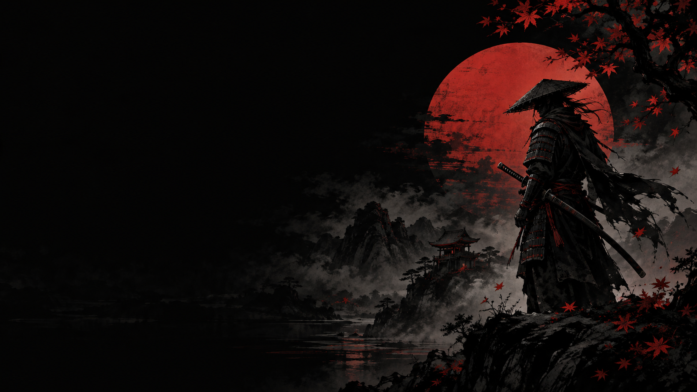

</details>

Personalize colors, spacing, cards and labels through the native **Lua UI studio**. [Commented example](docs/examples/simple-ui.lua) · [Lua guide](docs/LUA-UI.md) · [Brand assets](docs/BRANDING.md).

### 06 · Settings, languages and updates

A native **resizable Settings window**, with category cards and normal minimize/maximize/close controls. Closing it returns to the dock.

<p>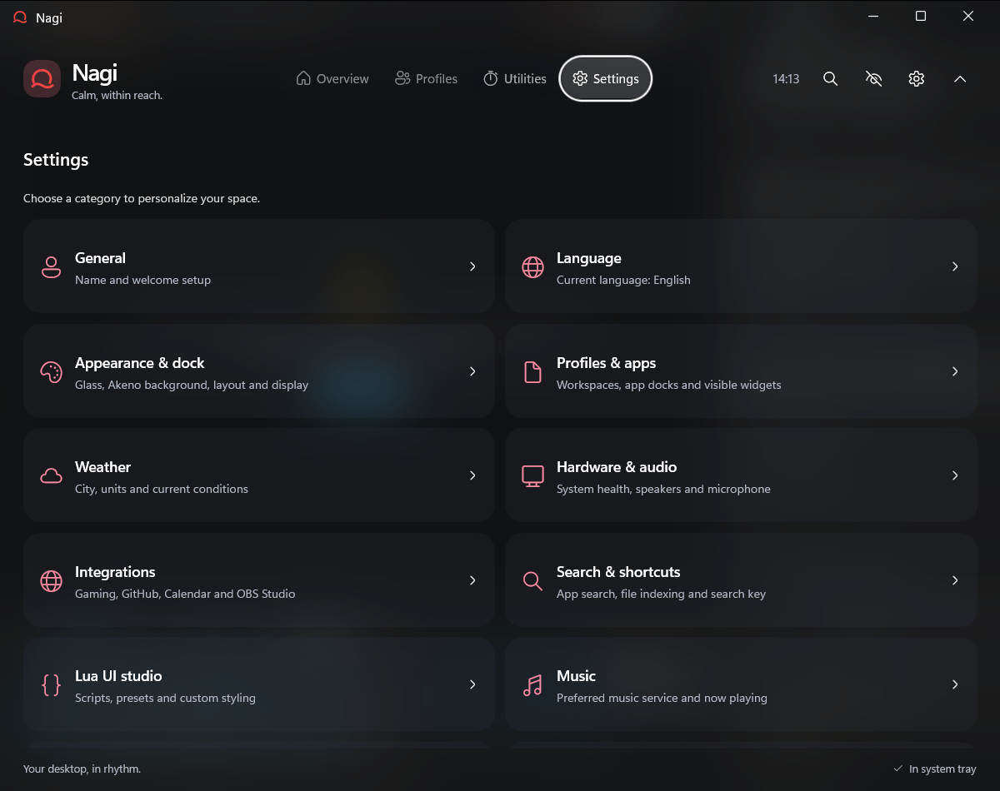</p>

**40 offline language packs**, including Japanese, Simplified and Traditional Chinese, Korean, Arabic, English, French, Spanish, German and Russian. Welcome selects your Windows language, shows the current choice and lets you switch before continuing. Chinese regional locales resolve to the appropriate script; right-to-left languages use the proper layout direction.

Contributors add a **UTF-8 JSON file**, without rewriting or recompiling UI code. Packs cover the current English string keys, with English fallback for future or missing phrases. New packs begin as machine-translated drafts; native-speaker improvements are welcome. [Languages and contribution guide](docs/LANGUAGES.md).

**Settings → Updates** automatically checks and downloads verified GitHub releases. Read the latest changelog, choose now or later, then use **Install and restart** when ready. Updates preserve preferences. The website's version badge, changelog and Windows download also follow GitHub's latest published release automatically.

### A lighter footprint

Display-aware animation cadence, an optional **60 Hz efficiency mode**, incremental file indexing and sampling tied to visible widgets. Fast audio peaks run only when a visible meter needs them. OBS connections and foreground profile detection stay independent. Hardware readings show unavailable states when a driver or provider cannot supply them.

## Make yourself at home

First launch draws **Nagi / ナギ**, then lets you choose a language, name, theme, layout and screen edge. OBS and weather are optional. Customize built-in profiles or create your own, then continue when your workspaces are ready. Later launches go straight to the dock.

[Welcome and layouts](docs/WELCOME-AND-LAYOUT.md) · [Complete guide](docs/USER-GUIDE.md).

## Functional modes

Gaming adds frame timing, available temperatures, active game time and Discord desktop status. Work becomes a Developer workspace with GitHub notifications, pinned repositories and Actions build status. Stream becomes a Creator workspace with a visible-only microphone meter and OBS/media controls. Focus keeps a saved task, a timer and your next meeting from an encrypted .ics file or HTTPS calendar feed. Custom profiles can choose any integrated mode; apply a layout explicitly to change its widgets. [Mode setup and provider requirements](docs/MODES.md).

| Gaming | Developer |
| --- | --- |
| 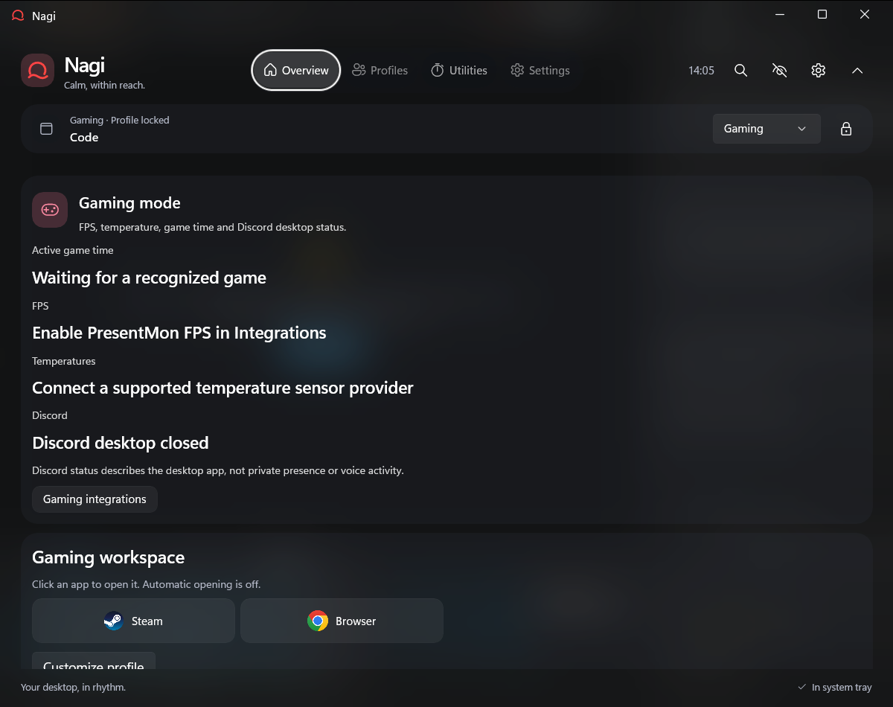 | 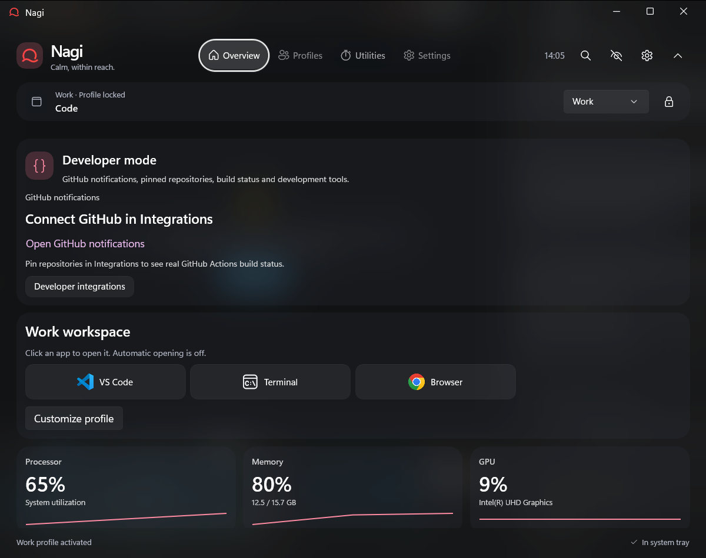 |
| Creator | Focus |
| 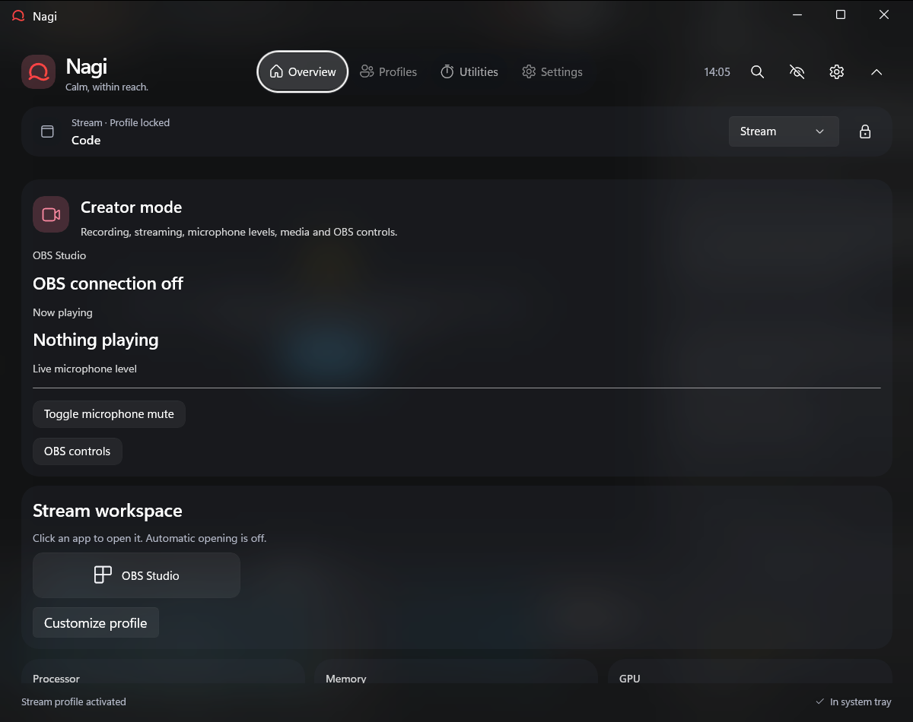 | 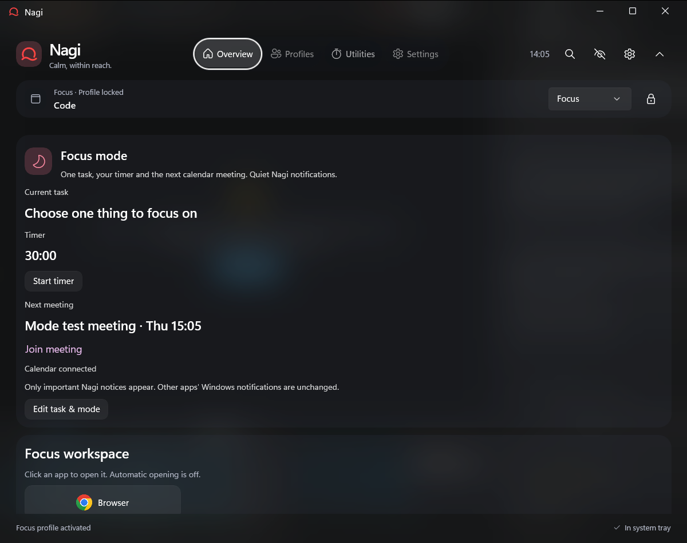 |

Native screenshots use isolated settings and a test calendar. Missing provider data stays visibly unavailable; FPS requires the Windows tracing permission described in the guide.

## A few useful moves

| Control | Action |
| --- | --- |
| Hover the drop | Reveal the dock |
| Hover the timer, media or app folder | Open its controls |
| Click the logo | Open the control center |
| Settings → Appearance | Choose dock edge and position |
| **Alt + Space** | Search apps, indexed filenames, calculations and commands |
| **Tab** in search | Cycle Nagi, Google and YouTube; or type browser:, google: or youtube: |
| **Ctrl + Alt + Space** | Expand/collapse the panel |
| **Ctrl + Alt + H** | Hide/show Nagi |
| **Escape** | Dismiss search or the expanded panel |
| Tray → **Quit Nagi** | Exit completely |

Try `app: chrome`, `file: report`, `folder: projects`, `> volume` or `24 * 7` in search. Filename indexing is optional and does not read file contents.

## Private by design

No account or activity telemetry. App settings, scripts, logs and protected OBS credentials stay in your local Windows profile. Weather sends only the city search or selected coordinates needed for its feature. Update checks contact GitHub; selected web searches open in your browser. Nagi does not save or transmit raw audio. Updates preserve preferences and Lua scripts.

GPU counters depend on the driver. Temperatures require a supported Libre Hardware Monitor/Open Hardware Monitor WMI provider; FPS requires PresentMon tracing permission; OBS requires its local WebSocket v5 server. [Integration setup](docs/INTEGRATIONS.md) · [Validation and remaining physical coverage](docs/VALIDATION.md).

**Settings → Integrations** brings Gaming, PresentMon FPS, GitHub, Calendar and OBS together. Optional local Steam/Epic/GOG recognition switches to Gaming when a game becomes active; explicit executable rules and profile locks keep priority. Enable FPS to show a stacked value beside CPU/GPU. If Windows denies tracing, FPS help can launch a separate helper after an explicit Windows permission request. **Hardware & audio** and **About & diagnostics** use responsive cards, with technical details tucked away and community thanks at the bottom.

Keep system information visible with **Settings → Behavior → Always show mini bar**. Hover details close when you leave; clicks do not pin the dock. Utilities weather uses the same city and forecast as the dock widget. Hide the magnifying glass separately with **Settings → Search & shortcuts → Show search button on mini bar**; keyboard and tray search remain available.

## Download

| Run it your way | Download | What to do |
| --- | --- | --- |
| **Portable EXE** | [Nagi-Portable.exe](https://github.com/alaaeddinemekkaoui/Nagi/releases/latest/download/Nagi-Portable.exe) | Open directly. Bundled app files are prepared automatically; no installation needed. |
| **Portable ZIP** | [Nagi-win-x64.zip](https://github.com/alaaeddinemekkaoui/Nagi/releases/latest/download/Nagi-win-x64.zip) | Extract the whole folder, then open **Nagi.exe**. Keep its files together. |
| **Install** | [Nagi-Setup.exe](https://github.com/alaaeddinemekkaoui/Nagi/releases/latest/download/Nagi-Setup.exe) | Install for your Windows user without administrator rights. |

Windows 11 **22H2 or newer**, x64. Runtime included. Current builds are unsigned. [Latest release, changelog and SHA256 checksums](https://github.com/alaaeddinemekkaoui/Nagi/releases/latest).

**macOS — Coming soon. Linux — Coming soon.** No builds or release dates are available yet. [Roadmap](https://nagi-notch.vercel.app/roadmap).

## Build and contribute

Built with **WinUI 3, Win2D and .NET**. [Build instructions](docs/BUILD.md) · [Architecture](docs/ARCHITECTURE.md) · [Documentation](docs/README.md) · [Changelog](CHANGELOG.md) · [Third-party notices](THIRD-PARTY-NOTICES.md).

```powershell
./scripts/Publish-NagiVariants.ps1 -NoRestore -ReleaseTag v0.2.2
```

Every release produces a fresh **Nagi-Portable.exe in the project root** and a matching **Nagi-Dev-Portable.exe**. Development includes a debug menu, direct pages, notch/notification previews, diagnostics and automated UI checks, with separate preferences and logs. Production excludes developer tools. [Developer guide](docs/DEVELOPMENT.md).

The dependency-free [website source](website/) includes the interactive tour, roadmap and live release feed. [Website development and deployment](website/README.md). The README and website keep corresponding sections for the notch, timer, media, dock, themes and settings.

## Thanks

Thanks to [u/alkidnn](https://www.reddit.com/user/alkidnn/) for suggestions, and [u/will25u1](https://www.reddit.com/user/will25u1/) for testing the mini bar and reporting hover/search issues. Thanks to everyone contributing translations, testing and ideas.
