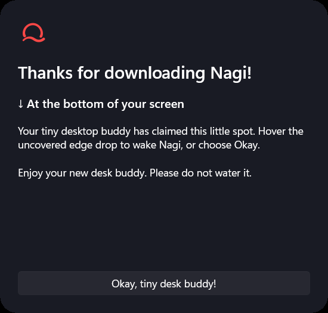
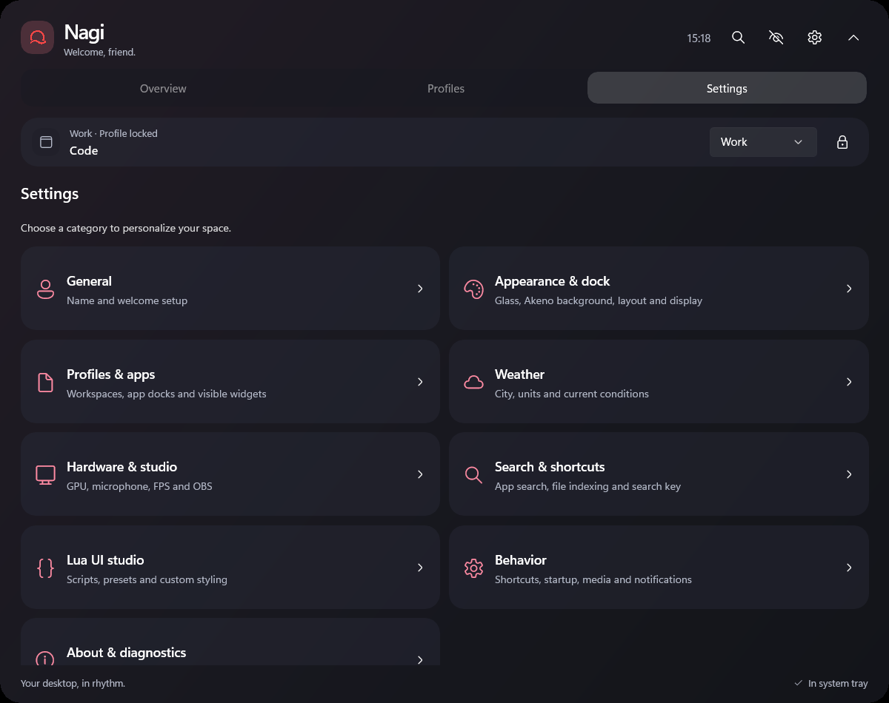
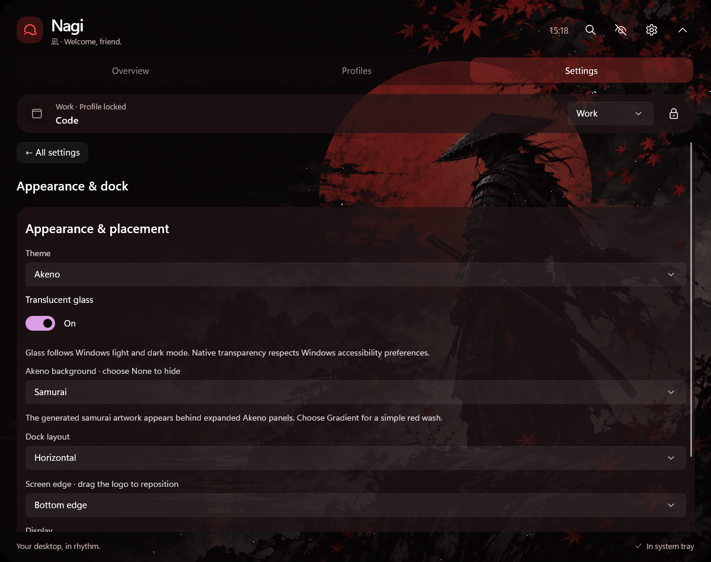

<div align="center">
  
  <h1>Nagi version 1</h1>
  <p><strong>A little space. More control.</strong></p>
  <p>A glass desktop companion for Windows 11. Your apps, music and useful information, tucked into the edge of your screen.</p>
  <p><strong>Windows 11 x64</strong> · Portable ZIP · EXE installer · No account required</p>
  <p><a href="#download">Download</a> · <a href="#make-yourself-at-home">First launch</a> · <a href="#your-desktop-your-rhythm">Features</a> · <a href="docs/USER-GUIDE.md">Full guide</a></p>
</div>

---

## Download

| Run it your way | Download | What to do |
| --- | --- | --- |
| **Portable** | [Nagi-win-x64.zip](https://github.com/alaaeddinemekkaoui/Nagi/releases/latest/download/Nagi-win-x64.zip) | Extract the whole folder, then open **Nagi.exe**. Keep its files together. |
| **Install** | [Nagi-Setup.exe](https://github.com/alaaeddinemekkaoui/Nagi/releases/latest/download/Nagi-Setup.exe) | Run setup, then open Nagi from Start. Installs for your Windows user without administrator rights. |

[Open the Nagi version 1 release](https://github.com/alaaeddinemekkaoui/Nagi/releases/latest) for both downloads and SHA256 checksums. Windows 11 **22H2 or newer**, x64. The runtime is included. The app and installer are unsigned.

## Make yourself at home

Welcome appears on your **first launch**:

1. Choose the name Nagi greets you with. It stays on this PC.
2. Pick a theme, **vertical or horizontal** layout, and your screen edge.
3. Connect local OBS, or skip it.
4. Choose a weather city and units, or skip weather.

Finish saves your choices. Nagi takes its place at the edge, dims the surrounding screen, and introduces your tiny desktop buddy. **Hover the uncovered drop** or press **Okay, tiny desk buddy!** to carry on. Please do not water it.

<details>
<summary>Meet your tiny desk buddy</summary>



</details>

Later launches go straight to your dock. Change anything in Settings, or revisit welcome through **Settings → General → Run welcome setup**. Updates preserve your preferences and Lua scripts.

## Your desktop, your rhythm

| | What Nagi brings |
| --- | --- |
| **A dock that belongs to the screen** | An edge-attached water drop, hover controls, inward-opening details and a large control center opened with one logo click. Vertical left/right or horizontal top/bottom. Native clipping removes opaque corner patches. |
| **Workspaces that fit the moment** | Work, Gaming and Focus profiles with editable app docks and independent widgets. Work suggests VS Code, Terminal and Browser; Gaming suggests Steam and Browser. Choose installed apps and optionally open them when you explicitly activate a profile. |
| **Music and audio** | Windows media artwork and supported playback controls, a live measured output visualizer, synchronized volume/mute and speaker/headphone selection. Microphone status and mute sit below media. |
| **Useful information** | CPU, memory, network, battery percentage and supported GPU readings. Optional city weather, temperature providers, PresentMon FPS and local OBS status/recording controls. |
| **Quick search** | **Alt+Space** for installed apps, indexed filenames/folders, calculations and Nagi commands. Filename indexing is optional and does not read file contents. |
| **Glass or a little drama** | Glass follows Windows light/dark mode by default. Akeno adds Japanese black/red styling with a generated samurai background; choose **Samurai**, **Gradient** or **None**. Windows transparency, high contrast and reduced-motion preferences are respected. |
| **Settings with a home for everything** | Category pages for general preferences, appearance, profiles, weather, hardware/studio, search, Lua, behavior and diagnostics. |
| **A personal touch** | Lua colors, spacing, cards, labels and overview sections, with a native editor, presets, reload and validation. |

<div align="center">
  
  <p><em>Pick a category. Make it yours.</em></p>
</div>

### Build your workspace

Open **Profiles → Customize Work / Gaming / Focus**. Add or remove installed apps and choose visible widgets: Performance, Network, Media, Audio, Microphone, Weather, Studio and Battery. The first four apps appear on the rail; Overview lists all configured apps.

**Open apps when I activate this profile** is off by default. Turn it on for a workspace you want to launch deliberately. Startup and automatic foreground detection update the dock and widgets without opening apps. Switching away does not close your applications. Missing suggested apps can be replaced in the profile editor.

### Give it some character

Choose **Settings → Appearance & dock → Akeno** for the samurai artwork. Prefer something quieter? Choose **Gradient** or **None**. Glass remains available for a theme that follows Windows.

<div align="center">
  
</div>

Or try this in **Settings → Lua UI studio → Edit Lua UI**:

```lua
-- A little red, a little breathing room.
return {
  name = "My Nagi",
  accent = "#FF4B4B", -- Highlight color.
  card_radius = 22,   -- Soft cards: 8–28.
  spacing = 12       -- Space between sections: 6–20.
}
```

[Commented example](docs/examples/simple-ui.lua) · [Complete Lua guide](docs/LUA-UI.md) · [Artwork provenance and generation prompt](docs/ASSETS.md)

## A few useful moves

| Control | Action |
| --- | --- |
| Hover the edge drop | Reveal your rail |
| Click the logo | Open the large control center and profiles |
| Drag the logo | Reposition the dock |
| **Alt + Space** | Quick search |
| **Ctrl + Alt + Space** | Expand/collapse the panel |
| **Ctrl + Alt + H** | Hide/show Nagi |
| **Escape** | Dismiss search, the introduction, or the expanded panel |
| Tray → **Quit Nagi** | Exit completely |

Try `app: chrome`, `file: report`, `folder: projects`, `> volume` or `24 * 7` in search.

## Private by design

No account, backend or activity telemetry. Settings, rules, scripts and protected OBS credentials live in `%LOCALAPPDATA%\Pulse` for compatibility with earlier development builds. Both the portable and installed app use this local Windows profile. Uninstalling preserves those files.

Weather is optional: explicit city searches and selected coordinates go to Open-Meteo. Nagi does not request GPS or IP geolocation. Web searches open in your browser only when selected. Audio meters show measured levels; Nagi does not save or transmit raw audio. OBS connection during welcome never starts recording.

## Requirements and checks

GPU counters depend on the driver. Temperatures require a supported Libre Hardware Monitor/Open Hardware Monitor WMI provider; FPS requires PresentMon tracing permission; OBS requires its local WebSocket v5 server. Media artwork and transport depend on the player. Nagi shows unavailable states rather than invented readings.

The current validation record covers automated behavior and Windows integration tests, isolated welcome/workspace UI checks, native window clipping and installer preference retention. Broader physical monitor, player, sign-in, clean-machine and accessibility coverage remains documented in [Validation](docs/VALIDATION.md).

## Explore further

[Complete app guide](docs/USER-GUIDE.md) · [Documentation index](docs/README.md) · [Welcome and layouts](docs/WELCOME-AND-LAYOUT.md) · [Hardware and OBS](docs/INTEGRATIONS.md) · [Build from source](docs/BUILD.md) · [Changelog](CHANGELOG.md) · [Third-party notices](THIRD-PARTY-NOTICES.md)

Built with WinUI 3, Win2D and .NET. The source retains its original Pulse project names; the app is **Nagi**.
