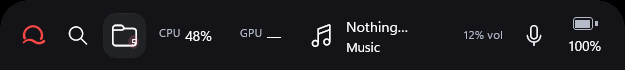
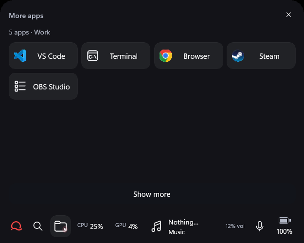

# Nagi app guide

This guide covers Nagi on Windows 11 x64, version 22H2 or newer. Start with the [welcome, layout, weather and speaker guide](WELCOME-AND-LAYOUT.md) for the new installer and welcome flow. Nagi has no account or backend.

## Contents

- [Install, update and start](#install-update-and-start)
- [Rail and window controls](#rail-and-window-controls)
- [Keyboard and tray controls](#keyboard-and-tray-controls)
- [System information](#system-information)
- [Media, audio and microphone](#media-audio-and-microphone)
- [Quick search](#quick-search)
- [Profiles, rules and quick actions](#profiles-rules-and-quick-actions)
- [Appearance and settings](#appearance-and-settings)
- [Lua customization](#lua-customization)
- [Hardware and OBS setup](#hardware-and-obs-setup)
- [Local data and privacy](#local-data-and-privacy)
- [Troubleshooting](#troubleshooting)
- [Quit and uninstall](#quit-and-uninstall)
- [Development and reference](#development-and-reference)

## Install, update and start

Open **Nagi-Portable.exe** directly, or extract **the entire Nagi-win-x64.zip** into a folder and open `Nagi.exe`. The portable EXE prepares its bundled files automatically and needs no installation. Keep the DLLs, assets and other files together. The self-contained release includes the application runtimes; it needs no .NET SDK. The current package is unsigned.

For a per-user installation, open PowerShell in the extracted folder and run:

```powershell
.\Install-Nagi.ps1
```

The installer copies Nagi into `%LOCALAPPDATA%\Programs\Nagi` and creates a Start menu shortcut. Administrator access is not required. Launch **Nagi** from Start. To update, extract the newer release into a separate folder and run its installer. It closes the installed copy gracefully before copying files; quit any portable copy before switching to the installed one.

Only one Nagi instance runs in the current Windows session. Launching it again reveals the existing instance. Startup is optional: open **Settings → Behavior → Start Nagi when I sign in**. Re-enable startup after moving a portable executable so the registered path points to the new location.

## Rail and window controls

Nagi normally rests as a small teardrop attached to your selected screen edge. Hovering reveals the dock. Your saved layout or **Open expanded on startup** preference can change its initial state.

1. Hover the teardrop to reveal the dock, horizontal or vertical.
2. Click once to pin the revealed controls open.
3. Click the Nagi logo to open the control center. A second click on the pinned edge control expands details inward.
4. Use **Collapse Nagi** or Escape to return toward the resting edge state.

Moving away retracts an unpinned reveal. A hover preview lets you inspect details without taking keyboard focus from the current app. Move into that preview to use its controls, or select **Show more** for the full panel.

The dock contains the Nagi logo, search, profile apps and enabled widgets. Up to three apps appear directly; additional apps share a folder tile with a count. **Hover or click the folder to expand it**, then click an app to open it. Moving from the folder tile into its app list keeps the folder open. Default starts without apps, so it has no folder. Removing extra apps hides the folder when three or fewer remain. Overview continues to show every app, up to four per row.

<p><strong>Resting teardrop</strong><br></p>
<p><strong>Hover reveals the dock</strong><br></p>
<p><strong>Hover expands extra apps</strong><br></p>

Hover CPU/GPU for system details, media for playback/audio, and OBS for studio controls when enabled. Drag the Nagi logo to reposition the dock. Under **Settings → Appearance & dock**, select Horizontal with the top/bottom edge or Vertical with the left/right edge, and choose a display. Panels open inward, adapt to DPI/work area, and the dock can scroll when space is limited.

The expanded panel provides **Overview**, profile/rule controls and **Settings**. Overview combines system metrics, media, output audio, integration status and quick actions. Hide removes Nagi from view while keeping Nagi running; Quit stops the application.

## Keyboard and tray controls

These are the defaults; all three global shortcuts can be changed in Settings.

| Control | Action |
| --- | --- |
| **Alt + Space** | Open Quick search |
| **Ctrl + Alt + Space** | Expand/collapse Nagi |
| **Ctrl + Alt + H** | Hide/show Nagi |
| **Escape** | Dismiss search or return Nagi toward the edge |
| Tray icon left-click | Reveal Nagi |
| Tray icon right-click | Open, search, hide, Settings, profiles and Quit |
| Nagi right-click | Open its quick menu |

The waveform tray icon may be under Windows **Show Hidden Icons**. Use **Settings** in its menu to recover a hidden window. Launching Nagi again is another recovery path. A shortcut conflict produces an error; the rail and tray remain usable, and a failed shortcut change keeps the previous registration.

## System information

| Reading | Meaning and availability |
| --- | --- |
| CPU | System-wide utilization from Windows counter deltas; a fresh launch needs a second sample |
| Memory | Physical memory usage, total and available memory |
| Network | Receive/send byte rates across active adapters; virtual adapters and multiple interfaces can affect totals |
| GPU | Busiest physical GPU engine from Windows performance counters, when the driver exposes them |
| Battery | Native Windows percentage and charging state; desktops can show AC and unknown values remain explicit |
| Foreground app | Active process identity used by profile rules; protected process paths may be unavailable |
| Temperatures | Readings from a supported, running WMI sensor provider |
| FPS | Optional PresentMon application-presentation rate for the foreground process |

Sparklines show real samples retained in memory. A missing value or provider status means a reading is unavailable; it is not replaced with a simulated number. The main polling interval is configurable from 500 to 10,000 milliseconds. Output audio has a separate 50 ms refresh loop.

## Media, audio and microphone

Start playback in a player or browser that publishes a Windows media session. Nagi displays the session's title, artist, artwork and playing/paused state. Artwork and transport availability depend on the player. Previous, play/pause and next controls are enabled when supported. Turn **Show media controls** off to hide that interface.

Output controls operate on the Windows default playback device. Overview and media-hover volume sliders stay synchronized with Windows; mute affects that output device. The visual meter reflects measured signal activity and can differ from perceived loudness. Volume remains available when no media session exists.

The rail microphone button toggles the **default communications microphone**. Hover it to identify the device and state. This can differ from the input selected inside a particular app. Nagi reads device state and controls mute without recording audio.

## Quick search

Press **Alt + Space**, click the rail search icon, or choose tray **Quick search**. Use Up/Down to select, Enter to open, and Escape to dismiss.

| Example | Search/action |
| --- | --- |
| `app: chrome` | Installed Windows applications |
| `file: report` | Indexed filenames |
| `folder: projects` | Indexed folders |
| `> volume` | Nagi commands |
| `24 * 7` | Calculator; Enter copies the result |
| `web japanese art` | Web search, sent to the browser when explicitly opened |

**Ctrl + Enter** opens the selected file's containing folder. **Ctrl + C** copies its path/result when query text is not selected. File results also provide Open, Show in folder and Copy path controls.

Configure indexing under **Settings → Quick search**. Standard roots are your Desktop, Documents and Downloads. Add/edit roots, restore standard folders, rebuild, or turn indexing off while keeping app search and commands. The index covers names and paths, with up to 16 roots and 40,000 entries. It refreshes at startup, after scope changes, on manual rebuild and every ten minutes. File contents, linked/system entries and common build folders are excluded. A newly created file may require a rebuild. See the [full search reference](QUICK-SEARCH.md) for syntax and bounds.

## Profiles, rules and quick actions

Nagi provides **Default**, **Work**, **Gaming**, **Stream** and **Focus**. Default starts with search, CPU/GPU and now playing, with no apps. Manual profile selection locks the choice until you select **Automatic** or unlock it. Focus quiets the dock and suppresses nonessential Nagi notices; Windows notification settings remain unchanged. Profiles organize app docks, visible widgets, context and shortcuts. They do not tune hardware or game settings.

After first-time welcome, a dimmed introduction points out the edge drop. Hover it or choose Okay to dismiss; Escape also closes the introduction. Welcome and this introduction are skipped on ordinary later launches. Your saved choices persist.

Click the rail logo once to open the large centered control center. Choose **Profiles → Customize Default/Work/Gaming/Stream/Focus** to edit a workspace. Work starts with suggested VS Code, Terminal and Browser apps; Gaming starts with Steam and Browser. Replace suggestions by selecting installed Windows apps, then **Add selected app**. Remove any app you do not need. The first three appear on the dock, with remaining apps grouped in a folder that expands on hover or click; Overview lists every app in rows of up to four single-line buttons. Missing suggestions show an actionable error rather than downloading or installing software.

Each workspace has independent Performance, Network, Media, Audio, Microphone, Weather, Studio and Battery checkboxes. Widget choices also filter the rail. Microphone, Weather and Battery can each be turned off independently per profile. Stream includes OBS controls; hover its OBS rail button to open OBS, start/stop recording or streaming, and switch between three scenes. Choose the scene shortcuts under Hardware & studio; Automatic uses the first three OBS scenes. **Open apps when I activate this profile** is off by default. When enabled, explicit activation from Profiles, the picker, tray or profile shortcuts opens that profile's configured apps. Startup and automatic foreground detection only update the dock and widgets. Apps launch through the current Windows application catalog, without shell arguments. Nagi does not close apps when switching away.


To map an app to a profile:

1. Open the profile/rule page and enable **Automatic context switching**.
2. Select **+ Add application rule**.
3. Enter an exact process name such as `Code.exe`, or a full local executable path.
4. Choose a profile and priority, then save.

Matching ignores case. Full paths match that specific executable; names match process identity. Highest priority wins, with existing list order resolving equal priorities. A candidate profile must remain stable for 1.8 seconds. When no rule matches, the selected fallback applies. Disabling automatic switching uses the fallback unless a manual lock is active. Fullscreen status controls visibility and does not automatically classify an application as a game.

Under **Quick actions**, use **+ Add quick action** to create an application, folder, file, HTTP(S) URL, profile or Nagi-toggle shortcut. Give it a label, target and optional profile filter. Edit/remove controls are beside existing entries. Local targets use absolute paths; application targets are `.exe` files without command arguments. Validation excludes script/command-host and indirect-shortcut targets. Actions run when selected and paths are checked again at execution.

## Appearance and settings

Settings always opens the category menu. Select a category to open its own page, then use **Back to settings** to return to the menu. The back button stays visible while the page scrolls. **Profiles & apps** stays inside Settings, including profile customization; **All profiles** returns to that category and **Back to settings** returns to the menu. The default **Glass (system)** appearance follows Windows light/dark mode and respects transparency and high contrast preferences. Akeno can display the generated Samurai artwork, a Gradient, or None. Microphone status and mute controls sit directly below the media card and inside the media preview.

| Group | Options |
| --- | --- |
| Appearance & dock | Glass (system), Akeno, Dark or Light; native glass; Samurai/Gradient/None background; layout; edge; display; reduced motion |
| Lua UI studio | Enable, edit/apply and explicitly reload a script; current status/errors |
| Quick search | Open launcher, search shortcut, indexing and folder scope |
| Hardware & studio | GPU/provider status, FPS toggle/helper guidance and microphone mute |
| OBS Studio | Connection toggle, port, password save/clear and status |
| Behavior | Outside-click dismissal, fullscreen hiding, expanded startup, media visibility, contextual notices, polling interval, panel/hide shortcuts and sign-in startup |
| Integrations & diagnostics | Version, session/device/provider status and diagnostic refresh |

**Akeno** uses ink-black glass, red accents and Japanese details. **System** follows the Windows light/dark theme. Windows high contrast remains authoritative. Glass can become opaque because of Windows transparency, power, remote-session or accessibility policy; diagnostics reports the material state. **Reduce motion** and Windows animation preferences disable motion effects while preserving the final layout.

With **Hide over fullscreen apps** enabled, Nagi hides over detected fullscreen applications. An explicit shortcut reveal can recover it. Turn **Dismiss when clicking outside** off if you want the detail panel to remain open while working elsewhere.

## Lua customization

For a small first example, open **Settings → Lua UI studio → Edit Lua UI**, paste this, and select **Apply script**:

```lua
-- Simple red highlights with softer cards.
return {
  name = "Simple red",              -- Appearance name.
  accent = "#FF4B4B",                -- Highlight color.
  card_radius = 22,                   -- Range: 8 to 28.
  spacing = 12,                       -- Range: 6 to 20.
  labels = { cpu = "CPU activity" }  -- Custom CPU label.
}
```

The [downloadable example](examples/simple-ui.lua) adds usage comments. Choose Akeno as the host theme to keep its Japanese decoration with this red accent. Lua changes appearance properties; the host retains docking, animations and native controls.

Applying saves UTF-8 source to `%LOCALAPPDATA%\Pulse\scripts\ui.lua` and enables Lua UI. Edit that file externally and select **Reload Lua UI** to apply it. A successful save backs up an existing file as `ui.lua.bak`. Turn **Enable Lua UI** off to restore the built-in appearance. Invalid edits report an error and retain the last working appearance in the current session; an invalid script at startup uses the built-in appearance.

Scripts can use `nagi.theme` (`Dark`, `Light`, `Akeno`) and `nagi.profile` (`Work`, `Gaming`, `Focus`). They are reapplied on theme/profile changes, not every audio frame. Supported options include card surface, metric labels and overview-section visibility. Source is limited to 32 KB and execution to 20,000 Lua instructions; filesystem/OS commands and arbitrary native controls are unavailable. See the [Lua API reference](LUA-UI.md) for every field and limit.

## Hardware and OBS setup

GPU counters and microphone controls use Windows directly when available. Temperature and FPS features need the corresponding provider/permission.

| Integration | Setup |
| --- | --- |
| Temperatures | Run Libre Hardware Monitor or Open Hardware Monitor with its supported WMI sensor publishing enabled. Nagi does not install a sensor driver. |
| FPS | Enable **Capture foreground app FPS**. If Windows denies tracing, run the separate bundled helper with the needed permission and the actual game PID. |
| OBS | Enable OBS's WebSocket v5 server, then enable **Connect to OBS** in Nagi and save the matching port/password. Default port: 4455. |

For the optional FPS helper, from the extracted or installed Nagi folder:

```powershell
# Replace 12345 with the game's PID. Use an Administrator PowerShell only if needed.
.\Start-NagiFpsCapture.ps1 -GameProcessId 12345
```

Enable FPS in Nagi and focus the game. Ctrl+C stops the helper. Nagi itself stays unprivileged. The reading counts application presents on the dominant swap chain; it is not the monitor refresh rate or guaranteed displayed frames.

OBS connects only to `127.0.0.1`. It reports recording, streaming and render-FPS state. The explicit **OBS record / Stop recording** button controls local recording; Nagi does not start a stream. The password is protected for the current Windows user with DPAPI and saved separately from JSON. **Clear saved OBS password** removes it. See [integration instructions](INTEGRATIONS.md) for provider requirements and failure states.

## Local data and privacy

Nagi is the new name for Pulse / Halo. The existing `%LOCALAPPDATA%\Pulse` data folder is retained so preferences, rules, scripts, the filename index and protected credentials carry over. The installation folder and Start menu entry use Nagi.

| Location under `%LOCALAPPDATA%\Pulse` | Contents |
| --- | --- |
| `settings.json` | Preferences, profile rules and quick actions |
| Settings backups/recovery copies | Previous or malformed configuration preserved during recovery |
| `scripts\ui.lua`, `ui.lua.bak` | Current Lua appearance and previous saved script |
| `Search\file-index.json` | Local filename/path index |
| `obs.credential` | Current-user DPAPI-protected OBS password |
| `Telemetry\foreground-presents.csv` | Optional FPS helper snapshot |
| `logs\pulse.jsonl`, `.previous` | Bounded local diagnostic records |

Activity history and metric samples stay in memory and disappear on exit. Nagi does not record keystrokes, screenshots or PCM audio, and has no activity telemetry. Registered hotkeys are handled globally; mouse-button state supports dragging. Search text stays local until you explicitly open a web search. Local paths and application configuration can be sensitive when sharing backups.

To back up customization, **Quit Nagi** and copy the settings and scripts to a safe folder. Restore while Nagi is closed. Prefer Settings for routine changes; JSON is versioned, uses atomic writes and preserves recovery copies. A newer unsupported schema is read-only. The OBS credential is tied to its Windows user and should be entered again on another account/machine. A fresh index can be rebuilt from the configured folders.

## Troubleshooting

| Symptom | What to check |
| --- | --- |
| Nagi disappeared | Tray → Open Nagi/Settings, Ctrl+Alt+H, or launch Nagi again; check fullscreen hiding and selected display |
| Hover rail closes | First click pins it; move into a preview to use it; use Show more for the full panel |
| Shortcut does nothing | Check the reported registration conflict and choose another shortcut; use rail/tray controls meanwhile |
| Glass looks opaque | Check Translucent glass, Windows transparency, high contrast and power/session policy; inspect material diagnostics |
| Missing artwork/playback button | Confirm the player publishes a Windows media session and supports that control; inspect Show media controls |
| Audio slider differs from a player | Nagi controls the default system output endpoint; inspect the device name and the player's own output/volume |
| Microphone state differs from an app | Compare that app's selected input with Windows' default communications microphone |
| File search misses an item | Check scope, indexing toggle, skipped folders and 40,000-entry cap, then rebuild |
| GPU/temperature/FPS unavailable | Read Hardware & studio status; check driver counters, running WMI provider or tracing permission as appropriate |
| OBS connection/recording fails | Check server enabled, v5 support, local port/password, and OBS recording folder/encoder status |
| Lua error | Check field spelling, value ranges and closing braces; reload a fixed script or disable Lua UI |
| Startup stopped after moving Nagi | Re-enable Start Nagi when I sign in from the new executable location |
| App fails after copying only its EXE | Extract the full release folder, including runtimes, PRI/XAML resources and assets |

For a fresh configuration, quit Nagi and rename its data folder to keep a backup, then relaunch. This resets preferences/index/customization; it does not remove the installed program. Review diagnostics and [validation](VALIDATION.md) before treating an environment-dependent reading as an app failure.

## Quit and uninstall

Choose tray **Quit Nagi** to stop sampling, release devices/hotkeys and remove the tray icon. Hiding only changes visibility.

For the per-user installation, run:

```powershell
& "$env:LOCALAPPDATA\Programs\Nagi\Uninstall-Nagi.ps1"
```

The uninstaller gracefully closes that installation and removes its app directory, Start menu shortcut and startup entry. Preferences, scripts and logs remain in `%LOCALAPPDATA%\Pulse`. A portable copy can be removed by quitting it, disabling its sign-in startup entry if enabled, and removing its extracted folder. Back up local customization before removing retained user data.

## Development and reference

Development needs the .NET 10 SDK, Windows SDK and Windows build tooling. From a source checkout:

```powershell
dotnet restore Pulse.sln
dotnet build Pulse.sln -c Release
dotnet test Pulse.sln -c Release --no-build
.\scripts\Run-Nagi.ps1 -Configuration Release
.\scripts\Publish-Nagi.ps1
```

The publish script creates the self-contained portable directory, ZIP and SHA256 file. Trusted signing requires a valid code-signing certificate; it is a separate release step. Source is split into WinUI presentation, Core policy/models, Windows integrations and Infrastructure persistence/Lua/indexing.

Use the [documentation index](README.md) for architecture, build prerequisites, licenses, validation and the v0.1.2 changelog. [Validation](VALIDATION.md) records Nagi v0.1.2 checks while distinguishing remaining physical-monitor, media-player, sign-in and accessibility coverage from completed checks.

## Music and app updates

When no media is detected, now playing offers YouTube Music, Spotify and Apple Music links. Under **Settings → Music**, choose All or one preferred service; only that service is offered when selected. Empty, inactive Windows media sessions do not hide these links. Paused tracks with metadata keep their playback controls.

Open **Settings → Updates → Check for updates**. A newer stable GitHub release can be downloaded and installed directly from the app. **Download updates automatically** checks at startup and every six hours and downloads verified packages; **Install and restart** completes the update when you are ready. Manual **Download and update** downloads and restarts in one action. SHA256 and package checks finish before the app closes. The updater replaces the current portable or installed app in place, retains preferences/scripts, and backs up replaced files for rollback. Update failures appear after restarting; a diagnostic log stays in the staging folder. A release needs the Windows x64 ZIP plus a GitHub SHA256 digest or matching `.sha256` asset.

## Activity, errors and updates

Settings → About & diagnostics opens the activity log (`logs/pulse.jsonl`) and the separate error log (`logs/errors.jsonl`) in your Nagi data folder. Logs include UTC timestamps, app version, theme and update events. Error entries include the exception and stack trace. Each file rotates independently at 1 MB.

When Nagi detects a newer release, it shows the changelog with **Update now** and **Later**. Update now downloads, verifies, installs and restarts. Later keeps Nagi running; with automatic downloads enabled, the verified download stays ready in Settings → Updates → Install and restart. A temporary failed check retries after two minutes. Preferences remain in the data folder across updates.
